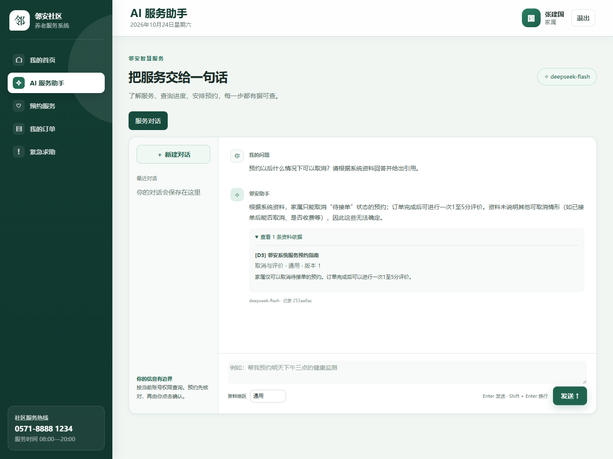
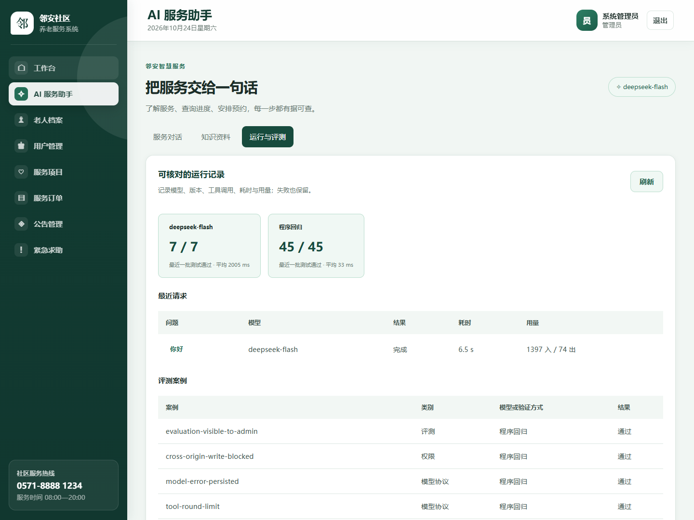

# 邻安社区养老服务系统 AI 助手

面向家属、护理人员和管理员的社区养老服务系统。
支持有原文引用的知识问答、授权业务查询，以及先核对再确认的服务预约。
模型通过标准 HTTPS API 接入，检索、权限检查和订单事务在后端执行。

**技术栈：** Node.js 22.13+ · Express 5 · MySQL 8 · DeepSeek API · BM25 · PDF.js · 原生 HTML / CSS / JavaScript

[安装与配置](docs/SETUP.md) · [系统架构](docs/ARCHITECTURE.md) · [测试与评测](#测试与评测) · [项目仓库](https://github.com/LSYM29/linan-elderly-care-ai)

## 页面预览

### 知识问答与原文引用



### 待确认预约卡片


### 管理端运行与评测



截图采集于 2026-10-24。问答与预约卡片来自独立预览库及真实模型调用，账号、资料和地址均为演示数据；卡片未确认下单。管理端展示已有评测记录，截图日期不代表重新执行评测。

## 功能

| 功能 | 实现方式 |
| --- | --- |
| 业务管理 | 用户与老人档案、服务项目、订单履约、评价、紧急求助和社区公告 |
| 知识问答 | TXT、Markdown、文字型 PDF 导入与切块，中文 BM25 检索，资料过滤与原文引用 |
| 业务工具 | 6 个白名单工具，通过登录会话与数据归属校验控制查询范围 |
| 预约确认 | 15 分钟草稿、修改与取消、显式确认、价格复核、事务及行锁控制重复提交 |
| 运行与评测 | 管理员查看工具轨迹、版本、耗时、Token 用量、评测结果与失败记录 |

## 本机运行

需要 Node.js 22.13+、MySQL 8；智能助手需要自行配置 DeepSeek API Key。

```sh
npm ci
node scripts/setup-env.js
npm run init-db
npm run init-ai
npm run config:api
npm start
```

默认地址为 <http://127.0.0.1:3002>。Windows 也可双击根目录的 `启动系统.bat` 和 `配置API密钥.bat`。完整步骤、配置表、错误提示及停止方式见 [安装与运行](docs/SETUP.md)。

## 演示账号与体验

| 角色 | 用户名 | 密码 |
| --- | --- | --- |
| 家属 | `family` | `family123` |
| 管理员 | `admin` | `admin123` |
| 护理人员 | `caregiver` | `caregiver123` |

家属登录后进入“AI 服务助手”：

1. 询问“预约后什么情况下可以取消？”，展开原文引用。
2. 询问“有哪些可以预约的服务？”或“我的预约进度怎么样？”，查看授权业务数据。
3. 提供服务、未来的具体日期时刻和详细地址，核对预约草稿，再决定是否点击“确认预约”。

只说“明天下午”需要补充明确时刻；聊天中的“确认”不会下单。演示库不含正式地方补贴政策，资料不足时应明确说明。账号和初始化资料均为合成演示数据。

## 架构与权限

网页通过 Express Session 登录后，后端检索资料、编排 DeepSeek 工具调用、校验引用并执行授权业务。模型没有 SQL、文件、系统命令或正式提交订单工具。普通预约与 AI 确认共用订单事务函数。

检索使用 BM25，复用 `ai_faqs`，文档与片段保存在 `ai_documents`、`ai_chunks`；未使用 Embedding 服务或向量数据库。完整数据流图、工具清单及权限边界见 [系统架构](docs/ARCHITECTURE.md)。

## 测试与评测

2026-10-17 已验证的结果：

| 检查类型 | 通过数 |
| --- | --- |
| 核心业务回归 | 19 / 19 |
| AI 集成 | 45 / 45 |
| HTTP 模型适配 | 25 / 25 |
| 完整 HTTP 链路 | 7 / 7 |
| 合计 | **96 / 96** |
| 真实模型最新一批评测 | **7 / 7** |

```sh
npm test
npm run eval:live
```

自动化检查覆盖角色与数据归属、资料过滤、PDF 提取、引用校验、工具参数、并发确认幂等和事务回滚。真实模型七个案例覆盖引用问答、无依据拒答、服务与订单查询、补齐预约信息、草稿生成及身份注入拦截。首批出现一次网络失败（6 / 7），增加有限网络重试后复测通过，历史保留；有限样本不代表所有输入下的准确率。

`npm test` 使用独立测试库和本机模拟模型，不消耗 API 余额；回归结束会把评测记录导入运行库。`npm run eval:live` 会消耗真实 API 余额，在独立 live 测试库运行，不自动确认预约。配置要求、输出路径和预期回滚日志见 [测试说明](docs/SETUP.md#测试与评测)。

## 目录与运行边界

```text
database/                业务与 AI 表结构
public/                  页面、样式和交互
src/ai/                  模型适配、检索、工具编排和业务权限
src/services/orders.js   公共订单写入逻辑
src/database-config.js   数据库名称校验
scripts/                 配置、初始化及评测入口
tests/                   业务、AI 和 HTTP 集成检查
docs/                    安装、架构说明及页面截图
server.js                Express 服务入口
```

源码附带 `.env.example` 和依赖锁文件；真实 `.env`、依赖目录及 `.runtime` 运行记录不入库。接收者需要配置自己的数据库与 API Key。

当前面向本机演示，使用内存 Session 和单进程并发限制，未验证大规模并发，未实现线上支付、OCR、向量检索或集群部署。上线前需配置 HTTPS、持久化 Session、生产日志与数据库备份，并处理演示账号。详见 [部署边界](docs/SETUP.md#交付与部署边界)。
