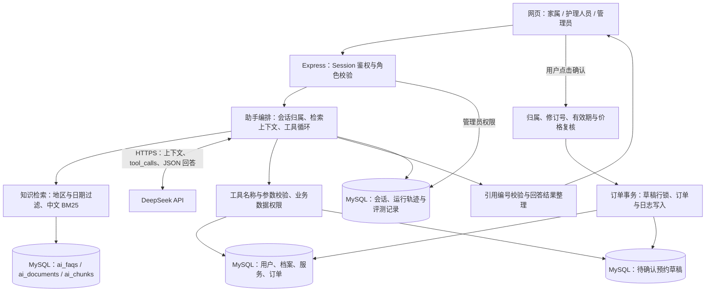

# 系统架构

系统由原生网页、Express 后端、MySQL 数据库和 DeepSeek API 组成。知识检索和业务执行在后端完成，模型负责理解需求、申请允许的工具及组织回答。

## 请求与数据流

## 知识问答

1. 管理员导入 TXT、Markdown 或文字型 PDF，后端解析正文，按章节切块；文字型 PDF 记录页码。扫描图片型 PDF 需要先做 OCR。
2. 文档与片段存入 `ai_documents`、`ai_chunks`，已有问答表 `ai_faqs` 继续使用。
3. 用户提问后，按启用状态、适用地区和有效日期过滤资料，以中文分词、双字词及 BM25 进行相关性检索。
4. 后端把资料片段、历史对话和当前问题交给模型；模型可通过 `search_knowledge` 再次检索。
5. 后端校验最终回答引用的来源编号，只展示本轮检索允许的资料。没有有效依据时，不生成确定的政策结论。

当前未接入 Embedding 服务或向量数据库，也没有 BM25 与 Embedding 的对比实验；本项目不声称 BM25 在效果上优于向量检索。

## 工具与权限

| 工具 | 功能 | 数据边界 |
| --- | --- | --- |
| `search_knowledge` | 检索知识片段 | 只返回适用、启用且在有效日期内的资料 |
| `list_services` | 查询服务与价格 | 读取当前启用的服务项目 |
| `get_my_elder_profile` | 查询老人基本档案 | 使用登录家属绑定的档案 |
| `list_my_orders` | 查询订单或护理任务 | 家属自己的订单、护理人员已分配任务，管理员按管理权限查询 |
| `get_order_detail` | 查询订单与履约记录 | 再次验证当前账号对该订单的访问权限 |
| `prepare_booking` | 生成待确认预约草稿 | 只有家属可生成，草稿不等于正式订单 |

用户身份来自服务端 Session，不接受模型提供的身份参数。模型适配层校验工具名称、必需参数、参数类型和允许字段；工具结果返回模型后，模型再组织最终回答。不提供 SQL、文件、系统命令或正式提交订单工具。

普通护理任务页面可以展示待接单任务供护理人员领取；AI 订单查询工具只返回已分配给当前护理人员的任务，两者的业务目的不同。

## 预约确认

草稿有效期为 15 分钟，支持修改、取消。聊天中回复“确认”不会提交订单，必须点击确认卡片。

确认接口在事务内读取并锁定草稿，检查归属、状态、修订号和有效期，再复核服务状态、内容及价格快照。重复确认已提交草稿时返回同一订单；订单与状态日志任一步失败都会回滚。普通预约与 AI 预约共用 `src/services/orders.js` 的订单写入逻辑。

## 运行记录与边界

`ai_sessions`、`ai_messages` 保存对话，`ai_runs` 保存提示词版本、知识版本、工具轨迹、耗时、Token 用量和失败原因。评测案例与结果保存在 `ai_eval_cases`、`ai_eval_results`，管理端展示最近批次汇总，并保留历史记录。

`GET /api/ai/status` 返回提供方、模型和配置是否就绪，不返回密钥。模型文本经过页面转义后显示，不执行其中的脚本。

当前版本面向本机演示，使用内存 Session 和单进程并发控制；没有完成长期运行及大规模并发验证。没有线上支付、OCR 或集群部署。安装、配置、错误提示和测试入口见 [安装与运行](SETUP.md)。

## 代码位置

| 路径 | 职责 |
| --- | --- |
| `public/js/assistant.js` | 对话、原文引用、预约卡片与管理页交互 |
| `src/ai/routes.js` | AI 路由、访问控制与接口连接 |
| `src/ai/assistant.js` | 检索上下文、模型与工具循环、引用校验和运行记录 |
| `src/ai/model.js` / `tools.js` | HTTPS 模型适配、工具协议及参数校验 |
| `src/ai/knowledge.js` / `retrieval.js` | 文档与片段管理、资料过滤和 BM25 检索 |
| `src/ai/pdf.js` | 文字型 PDF 提取 |
| `src/ai/business.js` | 授权业务查询、预约草稿及确认 |
| `src/services/orders.js` | 公共订单事务逻辑 |
| `src/database-config.js` | 独立数据库名称校验 |
